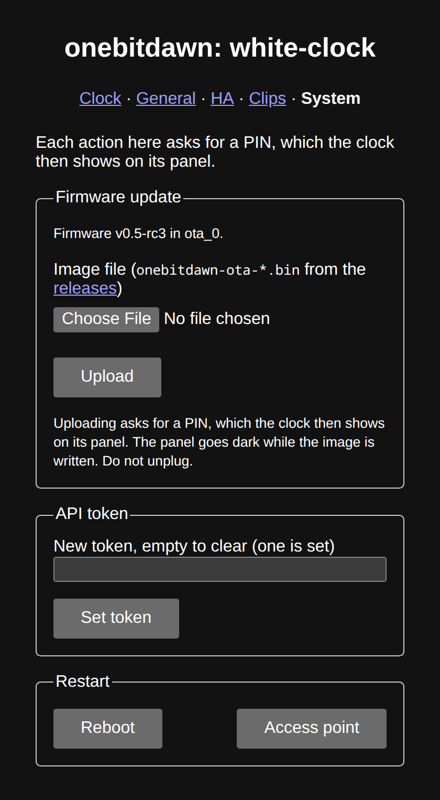
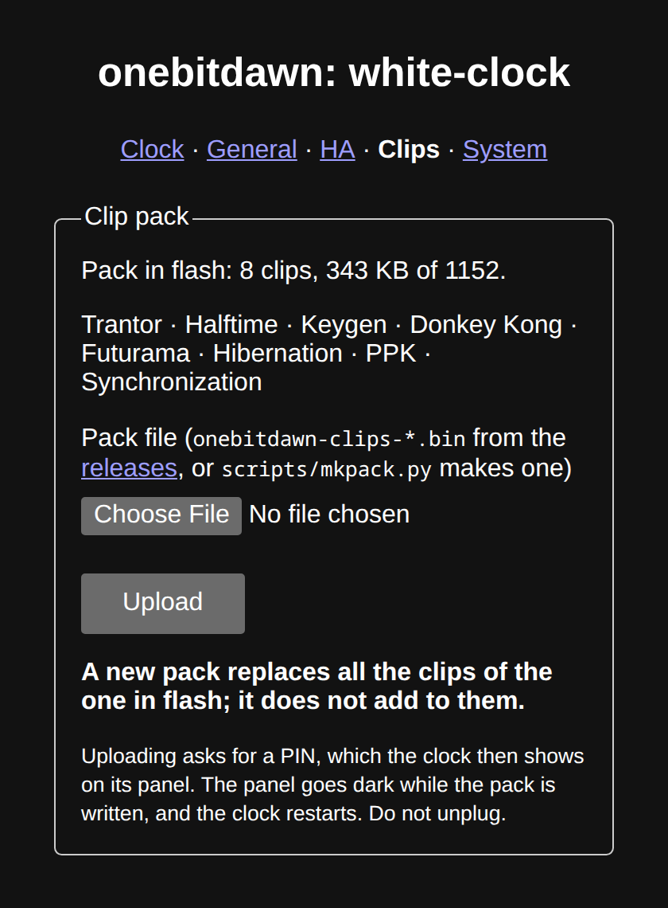
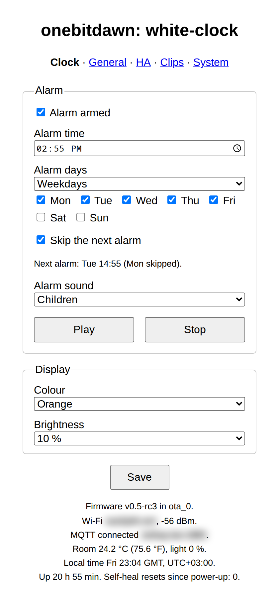
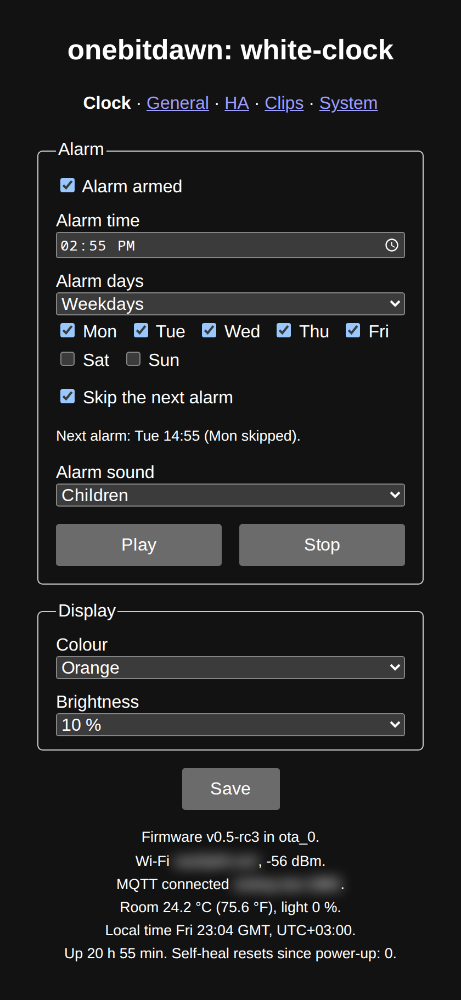
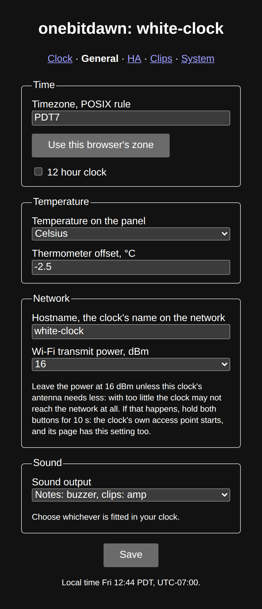
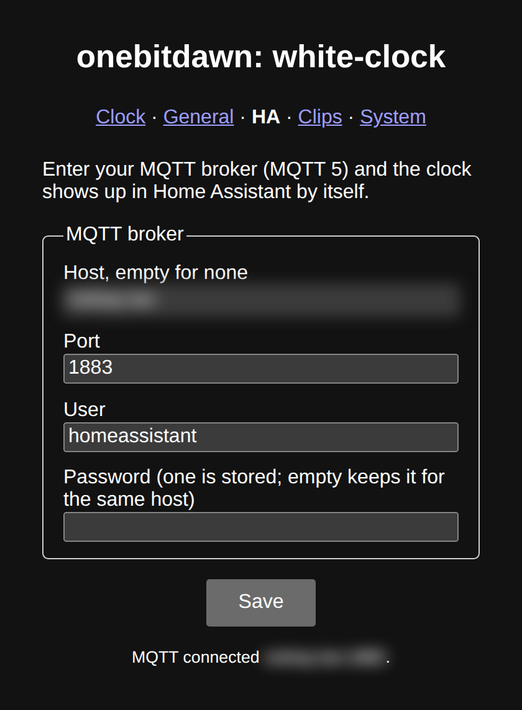

# onebitdawn manual

Building the firmware from source, installing and updating it, clip
packs, the buttons, the web pages, the API and Home Assistant. What
the project is and how to build the hardware is in `README.md`.

## Firmware

No toolchain is needed to run the clock: the
[web installer](https://anarsoul.github.io/onebitdawn/) flashes the
latest release from Chrome or Edge with the clock on USB, and later
updates come over the LAN; see [Prebuilt images](#prebuilt-images).
The rest of this section is for building from source.

### Prerequisites

- Rust stable 1.95 or newer. `rust-toolchain.toml` pulls the
  `riscv32imc-unknown-none-elf` target and `rust-src` by itself.
- [espflash](https://github.com/esp-rs/espflash) 4 for flashing,
  monitoring and making OTA images: `cargo install espflash`.
- `curl` for the scripts.

### Build and flash

The Wi-Fi credentials, the timezone and the API token are read from
the environment at build time and become the clock's defaults; all of
them can be changed later from the page and are stored in flash from
then on.

```sh
WIFI_SSID='home' WIFI_PASSWORD='…' TZ_RULE='<-07>7' API_TOKEN='…' cargo run --release
```

`cargo run` builds, flashes over the module's USB with the two-slot
partition table and opens the serial monitor. The first boot logs the
firmware version, the network and the address the clock got.

| variable | meaning | default |
| --- | --- | --- |
| `WIFI_SSID`, `WIFI_PASSWORD` | network to join; may be left empty, see provisioning | empty |
| `TZ_RULE` | the timezone as a POSIX TZ rule: `PST8PDT,M3.2.0,M11.1.0`, `CET-1CEST,M3.5.0,M10.5.0/3`, or `<-07>7` for a fixed UTC-7 | UTC |
| `TZ_OFFSET_MINUTES` | the older variable, minutes east of UTC, stored as a fixed rule (`-420` is `<-07>7`); `TZ_RULE` wins if both are set | 0 |
| `API_TOKEN` | bearer token for the scripts and the API's protected keys | none |
| `MAX_CURRENT_STEP` | LED current ceiling, 1 to 15; 5 is the 50 % step | 5 |
| `WIFI_TX_POWER_QDBM` | the default Wi-Fi transmit power in quarter dBm, for a clock with no stored setting: 8, 20, 28, 34, 44, 52, 56, 60 or 68 | 68 (16 dBm) |
| `AP_PASSWORD` | the clock's own access point's password | `onebitdawn` |
| `MQTT_HOST`, `MQTT_PORT`, `MQTT_USER`, `MQTT_PASSWORD` | the Home Assistant broker; empty host for no MQTT, see below | empty, 1883 |

### First boot without a network

A clock built without `WIFI_SSID`, or one whose two buttons are held for
10 s, starts as an access point. The panel shows `AP`, the network is
`clock-xxxx` (last two bytes of the MAC, WPA2, password `AP_PASSWORD`)
and the setup form is at `http://192.168.4.1/`; a phone's sign-in sheet
opens it by itself. Pick the network from the scan or type a hidden
one, set the timezone and hostname, save. The clock stores the record
and reboots into the network. Hold both buttons 10 s again to go back
to the access point if the password was wrong.

### Updates over the LAN

A running clock takes a new firmware over Wi-Fi, no USB. First get the
update image, `onebitdawn-ota-*.bin`, from one of three places:

- a [release](https://github.com/anarsoul/onebitdawn/releases):
  `onebitdawn-ota-<tag>.bin`, under Assets;
- the latest build of `master`: open the
  [Actions](https://github.com/anarsoul/onebitdawn/actions) tab, pick
  the newest run of the CI workflow on `master`, scroll to Artifacts
  and download `onebitdawn-ota-<commit>`. GitHub hands artifacts out
  as a ZIP (and asks you to be logged in); unzip it to get
  `onebitdawn-ota.bin`:

  ```sh
  unzip onebitdawn-ota-<commit>.zip     # leaves onebitdawn-ota.bin next to it
  ```

- your own build: `scripts/ota.sh` with no arguments builds it and
  prints the path (`target/onebitdawn-ota.bin`).

Then install it, either way:

- **From the browser.** Open the clock's System page,
  `http://<ip>/system`. Choose the `.bin` file and press Upload; the
  clock then shows a four-digit PIN on its panel for a minute, and
  the page asks for it. The panel is dark for the write,
  and the page waits for the clock to come back.
- **From the shell**, with the clock's API token (what you built
  with, or set on the System page; a prebuilt image has none until
  you set one):

  ```sh
  API_TOKEN='…' scripts/ota.sh <ip> onebitdawn-ota-<tag>.bin   # send this file
  API_TOKEN='…' scripts/ota.sh <ip>                             # build, then send
  ```

  The script is one `curl`: a `POST` of the raw file to `/ota` with
  `Authorization: Bearer <token>`.

<p align="center">
  
</p>

The new image goes to the other slot; a failed or interrupted write
leaves the running one in place, and a new image that cannot reach the
network within three boots, or hangs, is rolled back. Settings are
kept.

If a clip ever hangs the clock while it plays, the clock resets itself
and from then on rings and previews in notes only (a clip's melody as
the beeps), so the alarm still sounds. The clock page says "Clips
paused" above the alarm sound while that holds, `/api` has
`clips_paused`, and Home Assistant shows a "Clips paused" problem. A firmware update, a new clip
pack or a power cycle brings the clips back.

### Clip packs

The alarm melodies that are not notes (sampled sound, a ZX Spectrum
beeper tune, tracker modules, Commodore 64 and AY tunes) are clips,
and a clock's clips are a *clip pack* in a flash partition of their
own, `clips`, 1152 KB, so they can be changed without a new
firmware. The default pack is the four clips in `clips/`; a release
has it as `onebitdawn-clips-<tag>.bin` and the web installer writes
it.

```
scripts/mkpack.py packs/mine.bin clips/trantor.bpr wav/tune.pcm=My\ Tune   # up to 16 clips; see the script's head
API_TOKEN='…' scripts/clips.sh <ip> packs/mine.bin    # upload; without a file, the default pack is made and sent
espflash write-bin 0x2e0000 packs/mine.bin && espflash reset   # or over USB
```

or open `http://<ip>/clips`, which shows the pack in use and uploads
one with the PIN from the panel. The clock checks a pack (a SHA-256
at its end) when it is uploaded and at every boot, and restarts after
an upload. A pack with a clip in a version of its format the firmware
does not play (made by a newer converter, or a very old one) is
refused, by `scripts/mkpack.py` and by the clock, which finds it only
after writing the pack and is left with the note melodies until the
next upload: update the firmware, or convert the clip again. The alarm sound is stored by its place in the list, so
check it after changing packs; a sound that is no longer there is the
beeps.

<p align="center">
  
</p>

Sampled sound is made with `scripts/wav2pcm.sh in.wav wav/tune.pcm`
(16 KB of flash a second), or with the output named `wav/tune.adp` as
IMA ADPCM at half that, with a little noise added.

A clock flashed before the partition existed keeps its old partition
table through updates over the LAN: it runs the new firmware, with the
note melodies only, until it is flashed once over USB or from the web
installer (the settings survive both). `ALARM_CLIP=clips/trantor.bpr,…
cargo build --release` still builds clips into the firmware, for such
a clock; a pack, where there is one, takes their place.

### Prebuilt images

The easiest first flash needs no toolchain: open
<https://anarsoul.github.io/onebitdawn/> in Chrome or Edge with the
clock on USB, pick a release and press Install. The page is ESP Web
Tools over Web Serial; it writes the bootloader, the partition table,
an erased `otadata`, the firmware and the default clip pack, leaving
the settings partition alone, so a reflash keeps the settings unless you take the erase it
offers first. The [releases page](https://github.com/anarsoul/onebitdawn/releases)
has `onebitdawn-<tag>.bin`, the whole flash from offset 0 for
`espflash write-bin 0x0 onebitdawn-<tag>.bin` (then `espflash reset`;
this one covers the settings partition too and clears it), next to
`onebitdawn-ota-<tag>.bin`, the update image for `/system` and
`scripts/ota.sh`, and `onebitdawn-clips-<tag>.bin`, the default clip
pack (see above; the whole-flash image does not include it). A release is made by pushing an annotated tag `v*`
(`.github/workflows/release.yml`).

Between releases, every push is built on GitHub Actions
(`.github/workflows/ci.yml`) and the OTA image is attached to the run
as an artifact for 90 days; "Updates over the LAN" above says how to
fetch and install it. The images are built with:

| setting | value in the prebuilt images |
| --- | --- |
| network | none: the clock boots as an access point, see above |
| timezone | `<-07>7`, Vancouver (UTC-7, permanent since BC stopped changing clocks), no daylight saving. For another zone open `/settings` and press "Use this browser's zone", or type a POSIX TZ rule |
| API token | none: set one on `/system` for the scripts |
| everything else | the defaults: brightness cap 50 %, access point password `onebitdawn` |

The OTA image is an update image, for a clock that has been flashed
once over USB (the web installer or `cargo run` above); install it as
"Updates over the LAN" says.

A prebuilt image has no API token (a token printed here would let
anything on your network update the clock), so until you set one
everything that needs it goes from the clock's pages with the PIN on
its panel, and the scripts are refused. To use the scripts, open
`http://<ip>/system` and type a token (8 to 32 printable characters
without spaces) with the PIN the clock shows; to change it later,
there or with the old one:

```sh
curl -X POST -H 'Authorization: Bearer <old token>' -d 'token=<new token>' http://<ip>/token
```

The token is stored with the settings and survives updates;
`scripts/ota.sh` and the others want it in `API_TOKEN`. (The releases
up to v0.4 were built with the token `esp32clock`, and a clock that
saved its settings under one of them has it stored, until it is
changed or cleared.)

The token is what the scripts send as `Authorization: Bearer`; the
clock never shows it, only whether one is set. Setting an empty one
clears it, which closes the script paths (`scripts/ota.sh`, the
network and broker keys on `/api`) until a new one is set from the
System page with the PIN.

## Using the clock

| press | in clock mode |
| --- | --- |
| upper short | next colour |
| lower short | next brightness |
| upper long | set the alarm hour, then lower short for minutes, lower short again to leave |
| lower long | arm or disarm the alarm (the degree mark shows armed) |
| both long | show the IP address, one octet at a time, twice |
| both held 10 s | reset into the access point, or back to the network |

The IP display takes some decoding the first time. The first digit is
the octet's position, 1 to 4, and the other three are its value,
right-aligned, with the colon off. Each octet stays for two seconds
and the four go round twice. For `192.168.0.43` the panel shows:

```
1192    2168    3  0    4 43
```

A clock with no address yet shows `no1P` instead.

Any press ends a ringing alarm or the IP display.

The clock serves five pages, linked to each other at the top of each,
in the browser's light or dark:

<p align="center">
  
  
  
</p>

- `http://<ip>/`: the alarm (armed, time, days, skip the next one,
  the melody with Play and Stop) and the display (colour and
  brightness), saved together with Save, then the status: the
  firmware version and slot, the network and its signal, the broker,
  the room reading, the local time and the uptime.
- `/settings`: the timezone (a POSIX TZ rule; the button beside it
  fills in the browser's own zone, and the line under the form shows
  the local time the rule gives), 12/24 hour, the temperature on the
  panel and the thermometer's offset, the hostname, and the Wi-Fi
  transmit power (2 to 16 dBm, 16 by default; `tx_power` in `/api`).
  Lower it only for a clock whose antenna needs less: with too little
  the clock may not reach the network; then hold both buttons for
  10 s, and set it again on the access point's setup page. The access
  point itself always transmits at 11 dBm.
- `/ha`: the MQTT broker for Home Assistant, see below.
- `/clips`: the clip pack in use and the upload of another, see
  "Clip packs" above.
- `/system`: the firmware update, the API token, a reboot, and a
  switch to the access point for giving the clock another network.
  Each action puts a four-digit PIN on the panel when its button is
  pressed, and asks for it.

The clock answers a browser only under its own address or its
hostname, alone or with `.lan` or `.local` (`http://clock.lan/`), and
takes a form only from its own pages, so a web page elsewhere cannot
change the clock through a browser on your network. Under any other
name it redirects to its address. Scripts (`curl`) are not affected.

The same keys are available at `/api`: `GET` answers JSON, `POST` with
form-encoded keys applies all of them or none. A posted network, broker
or token needs `Authorization: Bearer <API_TOKEN>`. `scripts/configure-clock.sh`
is an example that sets a whole configuration in one request.

### Home Assistant

Fill in the Home Assistant page, `http://<ip>/ha` (or build with
`MQTT_HOST`, `MQTT_USER` and `MQTT_PASSWORD`) with the address of an
MQTT broker Home Assistant is on, and the clock appears under the MQTT
integration as a device named after its hostname, with no YAML: the
colour, brightness, alarm time, armed, skip, days, melody, 12 hour
clock, panel temperature and thermometer offset as entities you can
set, the room temperature, light, signal, uptime and self-heals as
sensors, a binary sensor that is on while the alarm rings, another
that is on while the clips are paused, and
buttons to play the melody, silence it or a ringing alarm, and reload
the clock. The broker must speak MQTT 5 (Mosquitto 1.6 and later, which includes the
Home Assistant add-on, does); the connection is plain, not TLS, so
give the clock a broker user of its own. Everything is under
`onebitdawn/clock-xxxxxx/` (the last three bytes of the MAC):
`state` is the `/api` JSON, `set/<key>` takes a value as `/api` does,
and `cmd` takes `play`, `silence` or `reload`:

```
mosquitto_sub -v -t 'onebitdawn/#'
mosquitto_pub -t onebitdawn/clock-a1b2c3/set/color -m cyan
```

Only the clock's own settings can be set this way; the network, the
hostname, the token and the broker itself cannot.

<p align="center">
  
</p>

## Development

The repository is a two-member workspace: the firmware is the root
package and `core/` is the hardware-independent half, a `no_std`
library with the display encoder, the settings record, the form and
page builders, the UI state machine and the sensor tables. Its tests
run on the host:

```sh
cargo build --release
cargo clippy --release
cargo host-test                                            # the core crate's tests, on the host
cargo clippy -p onebitdawn-core --target host-tuple --tests
```

Plain `cargo test` does not work: `.cargo/config.toml` aims every
cargo command at the chip, which is why the alias passes a host
target.

The CI workflow runs the same four commands, with clippy warnings as
errors, and builds the prebuilt image described above; the release
workflow does the same for a tag and publishes the images and the web
installer (`docs/index.html`, served from the `gh-pages` branch).

`ARCHITECTURE.md` describes how the firmware is put together: the two
crates, the tasks and what passes between them. `AGENTS.md` is the guide to working on the code: the rules, the
hardware facts that bite, the timing rules of the scan path and the
sizes that must be kept. The `agents/` directory has the detail
behind it: what each module holds, what the pages and services do,
the clip converters, and what was measured. `HISTORY.md` holds the design of each milestone
and what was measured on the panel, `PLAN.md` what is still to do.
