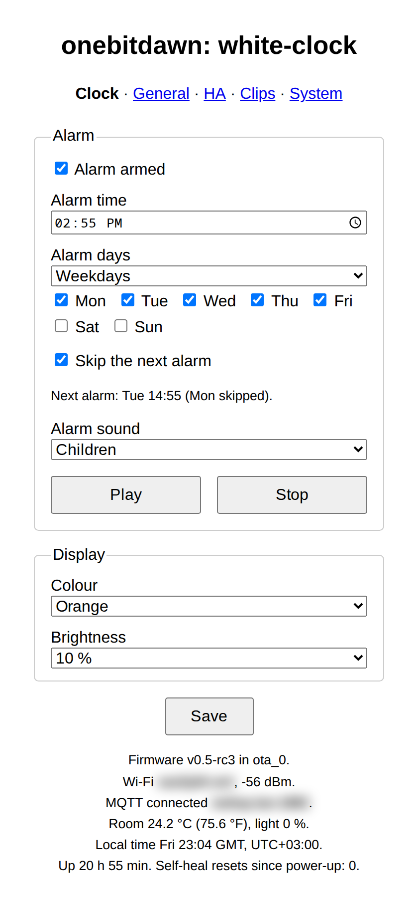
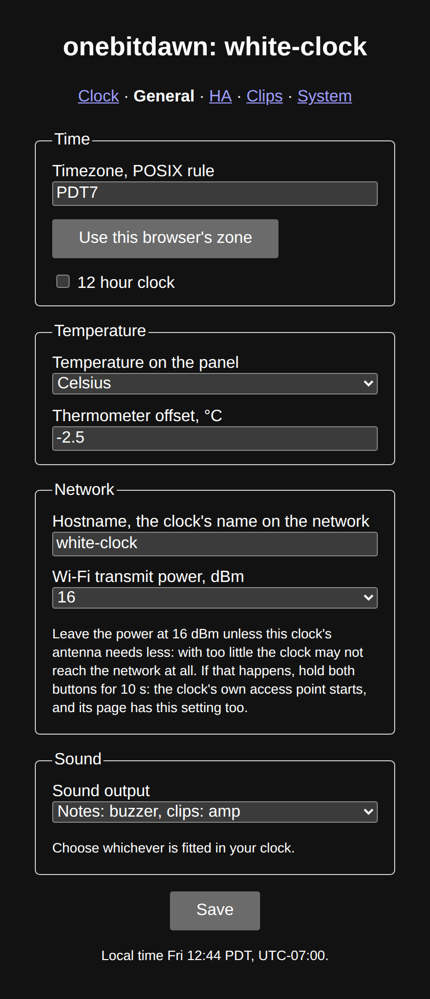
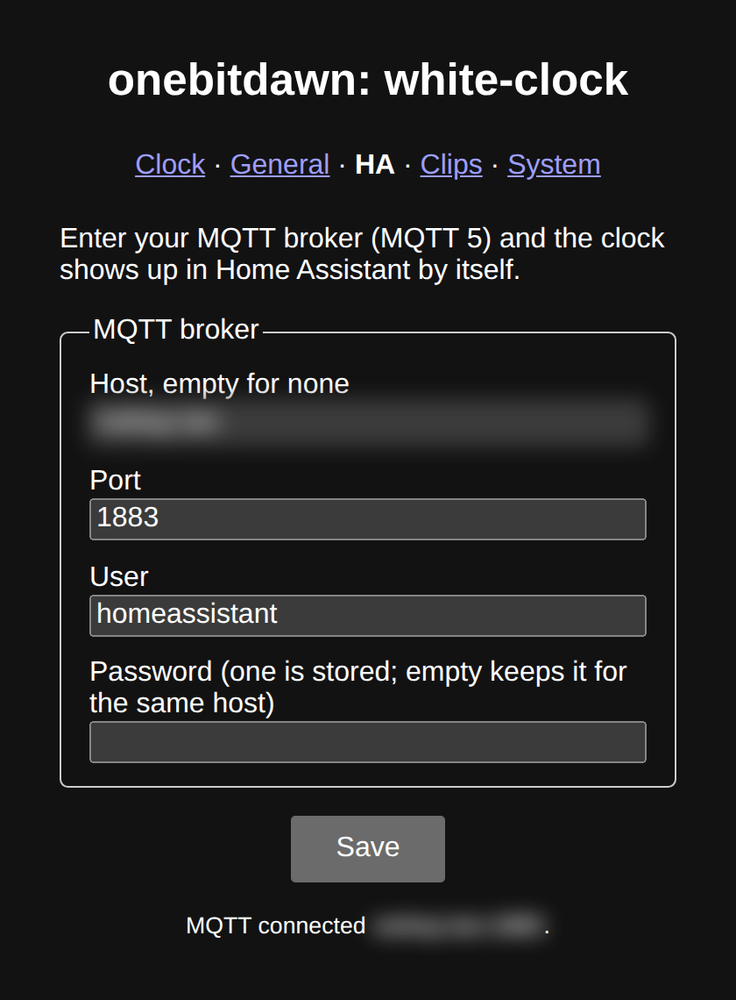
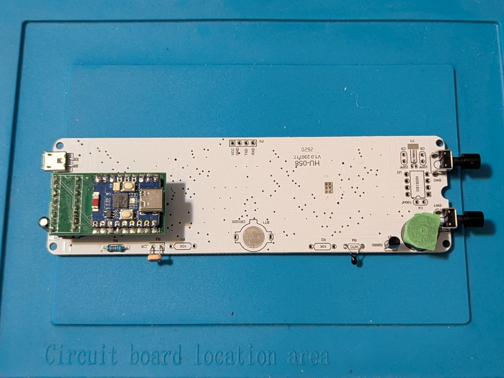
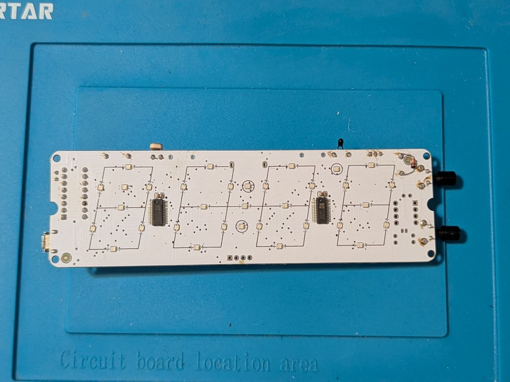

# onebitdawn

Open firmware for the HU-058 family of LED clock kits (HU-058 and
HU-058SE; the HU-058D should work too but is untested), with the kit's
8051 replaced by an ESP32-C3 on a small adapter board that takes the
8051's place in the DIP-16 footprint. Written in Rust with
[esp-hal](https://github.com/esp-rs/esp-hal) and Embassy.

It stands on [HU-058_ESPHome](https://github.com/misterblack1/HU-058_ESPHome)
by Adrian's Digital Basement (misterblack1), the original project,
which reverse-engineered the kit's display and its boards and put an
ESP32 with ESPHome in the 8051's place. Without that work this
project would not exist.

What the clock does:

- Time over NTP, 12 or 24 hour, in a timezone given as a POSIX TZ
  rule, so the clock follows daylight saving by itself.
- Alarm with a choice of melodies, per-weekday arming and a one-time
  skip.
- Nine colours and three brightness steps, from the buttons or the web
  pages.
- Room temperature and light level from the kit's NTC and LDR
  (optional), with the temperature on the panel once a minute.
- Web pages for the settings at `http://<ip>/` and a JSON API at
  `/api`.
- Home Assistant integration over MQTT with discovery, no YAML.
- Firmware updates over the LAN, two application slots with rollback.
- Setup from the clock's own access point, with a captive portal, when
  no network is stored.
- Self-healing: the clock resets itself when the network is lost for
  minutes or its firmware hangs (a watchdog), carrying the time and
  the alarm state across the reset.

<p align="center">
  
  
  
</p>

The clock's pages, in the browser's light or dark; the manual has
all of them.

[`MANUAL.md`](MANUAL.md) is the manual: building the firmware from
source, updates, the buttons, the pages, the API and Home Assistant.
`ARCHITECTURE.md` is the overview of the firmware, `HISTORY.md` the
design record, `PLAN.md` what is still to do and `AGENTS.md` the
maintainer's guide.

## How it differs from the original

The kit's brain is an STC8G1K17, an 8051 with closed firmware. It
scans the display, reads the buttons and the sensors and drives the
buzzer; the time comes from a DS1302 and a coin cell, set with the
buttons (HU-058, HU-058SE), or from an ESP-01S that only passes the
time to the 8051 (HU-058D).

The original project,
[HU-058_ESPHome](https://github.com/misterblack1/HU-058_ESPHome),
replaced the 8051 with an ESP32-WROOM-32 running ESPHome, wired to
the socket's pins. This project starts from its documentation of the
display and differs in these ways:

- An ESP32-C3 module on an adapter board that goes in the 8051's
  footprint, so nothing is wired by hand.
- Its own firmware, in Rust, and not ESPHome: the clock keeps the time
  and its settings by itself and has its own web pages, and Home
  Assistant is optional.
- The display is scanned by hardware: SPI2 in quad mode used as a
  four-wire pattern generator, on one DMA transfer that loops for
  ever. The refresh is 7.1 kHz against about 400 Hz, with no flicker
  and nothing Wi-Fi can disturb.
- The buzzer, the thermometer and the light sensor are used: an alarm
  with melodies and [clips](#clips), and the room's readings.

## Hardware

### Parts

| part | notes |
| --- | --- |
| HU-058 or HU-058SE kit | the display half comes preassembled; the through-hole side is what you build. Sold on AliExpress as "DIY KIT Electronic Clock LED Microcontroller Soldering Exercise" (links in the [HU-058_ESPHome](https://github.com/misterblack1/HU-058_ESPHome) README). Get this one rather than the pricier HU-058D "ESP8266 IoT Colorful WiFi Clock Kit": the 8051 and the ESP-01S both go unused either way, and the D is untested here |
| ESP32-C3 module | an ESP32-C3 SuperMini **Plus**, the one with an antenna socket, with a small external antenna, is the one to get; a plain ESP32-C3 SuperMini or a Waveshare ESP32-C3-Zero works too, with weaker Wi-Fi. One adapter design for each footprint |
| adapter PCB | KiCad projects and gerbers in `adapter/adapter-esp32c3-zero` and `adapter/adapter-esp32c3-supermini`; two layers, 1.6 mm, any board house. Or order it from [PCBWay](https://www.pcbway.com/project/shareproject/esp32c3_adapter_for_HU_058_clock_e419ee2a.html), which supports this project |
| pin header | the one that comes with the module |
| 2 × 10 kΩ 0603 resistors, ideally 1 % | R1 and R2 on the adapter; only needed for the temperature and light sensors |
| 10 µF 25 V electrolytic capacitor | replaces the kit's C3, optional but recommended |
| 1N4148 diode, a 5.1 kΩ resistor | the buzzer mod: optional, but the clips do not sound good without it |
| 5 V USB power supply | 1 A recommended; 500 mA works |

### The clock board

Most of the kit stays in the bag.

**Fit these:**

| reference | part | why |
| --- | --- | --- |
| SW1, SW2 | 6 × 6 mm tactile switches | the two buttons |
| Q1 | S8550 PNP | buzzer driver |
| R5 | 10 kΩ, or 5.1 kΩ with the buzzer mod | base resistor of Q1 |
| LS1 | buzzer | the alarm |
| USB1 | micro USB | 5 V in |
| R4, R3 | NTC thermistor, LDR | optional: room temperature and light level |

**The sensors.** If you fit R3 and R4, also fit R1 and R2 on the
**adapter**. Do **not** fit the kit's own R1 and R2: they pull the
sensors up to 5 V, more than the ESP32-C3's inputs may see, where the
adapter's pull up to 3.3 V. Without the sensors, leave all four off;
the clock shows the time only.

**Replace C3**, a 0.1 µF ceramic on the 5 V rail next to the MCU
footprint, with a 10 µF 25 V electrolytic capacitor. Fit it last,
after the adapter is in place, since it stands in the way of soldering
the adapter. The negative lead goes towards the top of the board.

**Leave out everything else:** the STC8G1K17 (U4), the kit's R1 and
R2, header P3, and the timekeeping parts. On the HU-058 and HU-058SE
those are the DS1302 (U3), the crystal Y1 with C5 and C6, and the
CR1220 holder BT1; on the HU-058D the ESP-01S socket P5, the AMS1117
regulator U3 with C4 and C5, and R6 and R7. If you bought the kit
assembled, pull the 8051 and (on the HU-058D) the ESP-01S out of their
sockets before the adapter goes in.

**The DIP-16 socket is optional.** The adapter stands on the pin
header that comes with the module. If those pins fit the socket's
contacts and there is clearance under the adapter, fit the socket and
the adapter is removable; if not, solder the adapter's header straight
into the U4 footprint.

**The buzzer mod, optional:** two changes that make the alarm louder
and cleaner. The beeps and the note melodies are fine on a stock
board; the [clips](#clips) are not, so do the mod if you want them:
without it they are quiet and distorted. The firmware is the same
either way.

- A flyback diode, a 1N4148 will do, across the buzzer's two pins on
  the solder side: the cathode (the end with the band) to the pin Q1's
  collector drives, the buzzer's `+`, and the anode to the ground pin.
  Without it the buzzer's coil kicks that pin to 10 to 15 V below
  ground every time Q1 turns off.
- 5.1 kΩ for R5 instead of 10 kΩ, which doubles Q1's base current, so
  the transistor switches harder and the buzzer is louder.

<p align="center">
  
  
</p>

A board with the mod. On the component side the 5.1 kΩ R5 is in its
place by the adapter. On the solder side the 1N4148 is across the
buzzer's two pins, in the corner by the buttons. The green on top of
the buzzer is masking tape over its opening, with a small hole made
by a needle, which makes a Helmholtz resonator of the buzzer's
cavity: not one of the two changes, but the tunes come through
louder.

With the mod Q1 gets hot to the touch while a clip of sampled sound, a
tracker module, a SID or a PT3 tune plays. Such a clip is a stream of
pulses 125 to 250 ns long, and the transistor cannot switch that
fast: with under a milliamp of base current its edges are no shorter
than the pulses. So for the length of the clip it never gets fully on
or off and sits in its linear region, half on, with the buzzer's mean
current through it: about 156 mA at 2.5 V at the worst, 0.4 W for the
buzzer's 16 Ω coil on 5 V, inside the S8550's rating of 0.625 W. It stays cold
when idle, on the beeps and on a beeper clip, whose pulses are long
enough to switch on. Q1 stands next to the NTC, so the firmware holds
the temperature at what it was before such a clip, for its length and
up to twenty minutes after.

[`speaker-mod/`](speaker-mod/README.md) describes a speaker in the
buzzer's place. Its base resistors, 330 Ω for R5 and 100 Ω from base
to emitter, drive Q1 hard enough to switch on every pulse, so with
that mod the transistor stays cool while a clip plays.

### The adapter

A two-layer board with the ESP32-C3 module on top, two 0603 pads (R1,
R2) and a DIP-16 footprint underneath for the module's pin header.
Build it in this order, since each step covers the pads of the next:

1. R1 and R2 (10 kΩ, 0603, ideally 1 %), if the clock board has the
   NTC and LDR.
2. The module. The antenna end hangs over a notch in the adapter's
   edge on purpose; do not let it sit over copper or over the clock
   board. With a SuperMini Plus, plug the external antenna into its
   socket and check that the module's antenna-select pad, where it has
   one, points at the socket.
3. The pin header, into the DIP-16 footprint, pins down.
4. Plug the adapter into the kit's socket, or solder its header into
   the U4 footprint. Pin 1 is the end marked on the clock board's
   silkscreen. Fit C3 on the clock board after this.

A module with a ceramic chip antenna normally works, but far from the
access point, or with the clock in its case on a shelf, the uplink
gets marginal: the access point hears the clock about 20 dB worse than
the clock hears it. An external antenna has been measured 25 to 30 dB
better than the chip antenna in the same spot.

Some ESP32-C3 SuperMini boards with the ceramic antenna need a lower
transmit power: at the default, 16 dBm, their antenna's mismatch makes
the link worse, not better, and the clock may fail to join its network
at all. The clock's own access point always transmits at a low power,
11 dBm, whatever the setting, so it can be reached either way. If the
clock does not connect to your network, hold both buttons for 10 s to
put it back into the access point, and choose a lower transmit power
on the setup form at `http://192.168.4.1/`; go down a step at a time
until it connects.

What the adapter connects:

| ESP32-C3 pin | socket pin | net | role |
| --- | --- | --- | --- |
| GPIO9 | 5 | DATA | driver 1 data |
| GPIO8 | 16 | CLK | driver 1 clock |
| GPIO7 | 2 | DATA_1 | driver 2 data |
| GPIO6 | 1 | CLK_1 | driver 2 clock |
| GPIO4 | 10 | S2 | upper button |
| GPIO3 | 9 | S1 | lower button |
| GPIO5 | 11 | R_B | buzzer, open-drain |
| GPIO0 | 3 | R_T | NTC divider, adapter R2 10 kΩ to 3V3 |
| GPIO1 | 4 | R_P | LDR divider, adapter R1 10 kΩ to 3V3 |
| 5V | 6 | +5V | supply |
| GND | 8 | GND | ground |

The HU-058D has driver 1's clock on socket pin 14 and not 16, so on a
D board a short wire from pin 14 to pin 16 should be needed. That
follows from the schematics; the HU-058D is untested.

### The lid

If the case needs more room, as for an adapter standing on its pin
header that no longer clears the original back lid, `lid/lid.scad` is
a parametric OpenSCAD model of a raised lid, for 3D printing. It has
the original's outline and takes the original screws; `raise` is how
much higher than the original it stands, 10 mm by default.

```sh
openscad -o lid.stl lid/lid.scad                    # raised by 10 mm
openscad -o lid.stl -D raise=6 lid/lid.scad         # or by another height
openscad -o lid.stl -D speaker=true lid/lid.scad    # with a socket for the speaker mod's speaker
```

`lid/lid-v2-printed.stl` is the 10 mm one as printed, which fits the
case.

### Power

Feed 5 V through the clock's own micro USB (USB1). A 1 A supply is
recommended; a 500 mA phone charger works. The firmware caps the drive
current at the 50 % brightness step by default; raising the cap on a
weak supply makes the board brown out when the brightness is stepped
up.

While the module is on USB for flashing, its 5 V pin feeds the clock
board, so the panel lights up on the bench. Do not power the clock
from USB1 and the module from its own USB at the same time.

### Firmware

No toolchain is needed: open the
[web installer](https://anarsoul.github.io/onebitdawn/) in Chrome or
Edge with the module on USB, pick a release and press Install. Or
build from source, with Rust 1.95 or newer and
[espflash](https://github.com/esp-rs/espflash) 4:

```sh
WIFI_SSID='home' WIFI_PASSWORD='…' TZ_RULE='PST8PDT,M3.2.0,M11.1.0' cargo run --release
```

A clock with no network stored starts as an access point: the panel
shows `AP`, the network is `clock-xxxx` with the password
`onebitdawn`, and the setup form is at `http://192.168.4.1/`. Holding
both buttons for 10 s gets there too. Everything after that, the
build's other variables and updates over the LAN included, is in
[`MANUAL.md`](MANUAL.md).

## Clips

The alarm melodies that are not notes are clips: sampled sound (PCM or
ADPCM), a ZX Spectrum beeper tune, FastTracker 2 modules, Commodore 64
SID tunes and ZX Spectrum AY tunes (Pro Tracker 3), the last three
played by the clock's own players and chip emulations. A clock's clips
are a clip pack in a flash partition of their own, so they can be
changed without a new firmware, from `http://<ip>/clips` or with
`scripts/clips.sh`. The default pack is the four clips in `clips/`,
and the web installer writes it. They are made for a clock with
[the buzzer mod](#the-clock-board); a stock board plays them, but not
well.

The clips are other people's music and not under this project's
licence; [`clips/README.md`](clips/README.md) credits each. Making
clips and packs is in the manual's
[Clip packs](MANUAL.md#clip-packs).

## License

MIT or Apache-2.0, at your option. See `LICENSE-MIT` and
`LICENSE-APACHE`.

The display protocol and the board documentation come from
[misterblack1/HU-058_ESPHome](https://github.com/misterblack1/HU-058_ESPHome)
by Adrian's Digital Basement, the reverse-engineering project for
this kit, released as CC0. Its `docs/` directory has the AiP33628
protocol, the display map and the schematics of all three board
variants.

Much of this project, firmware and documentation alike, was written
with the assistance of an AI coding agent (Claude), working from the
design, the measurements on the panel and the review of the author.
Every change was built, run through the host tests and checked on the
hardware before it was kept, but read the code with that in mind, and
report what looks wrong.
